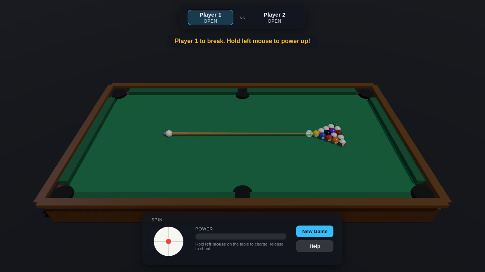

# Carom — 3D Pool

A browser-based **3D pool (8-ball) game**, inspired by *Carom 3D*. Built with
[Three.js](https://threejs.org/) for rendering and a custom billiards physics
engine (sliding/rolling friction, spin/english, cushion banks, and pockets).



## Play

The game is fully self-contained — Three.js is vendored under `vendor/`, so no
internet connection or build step is required. You just need to serve the
folder over HTTP (ES modules don't load from `file://`).

```bash
# Option A: Python (built in on most systems)
python3 -m http.server 8080

# Option B: npm
npm start
```

Then open <http://localhost:8080> in a modern browser.

## How to play

It's standard **8-ball**:

- **Aim:** move the mouse over the table — the cue stick tracks your pointer.
- **Shoot:** hold the **left mouse button** to charge power, release to strike.
- **Spin (english):** click inside the spin circle (bottom-left) to set where the
  cue tip strikes the ball — top/bottom for follow/draw, sides for english.
- **Rotate the camera:** drag with the **right mouse button**.
- **Zoom:** mouse wheel.
- **Ball in hand:** after a foul, click an open spot to place the cue ball.

Pocket all of your group (**solids** 1–7 or **stripes** 9–15), then sink the
**8-ball** to win. The table is *open* until the first ball is legally pocketed,
which assigns the groups.

**Fouls** (opponent gets ball in hand): scratching the cue ball, hitting the
wrong group first, or failing to drive any ball to a rail. Potting the 8-ball
early — or scratching on it — loses the game.

It's two-player hot-seat on a single screen.

## Project layout

```
index.html        Page shell, import map, HUD
styles.css        UI styling
js/physics.js     Headless billiards physics engine (no rendering deps)
js/scene.js       Three.js scene: table, balls, cue, camera, lighting
js/main.js        Game loop, input, and the 8-ball rules engine
vendor/three/     Vendored Three.js (module build + OrbitControls)
```

The physics engine in `js/physics.js` has no dependency on Three.js or the DOM,
so it can be unit-tested directly under Node.

## Notes / ideas for later

- AI opponent for single-player.
- A true carom (three-cushion, pocketless) mode, closer to the original game.
- Number decals and reflections on the balls; sound effects.
